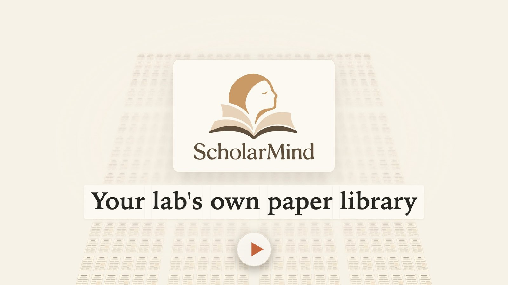
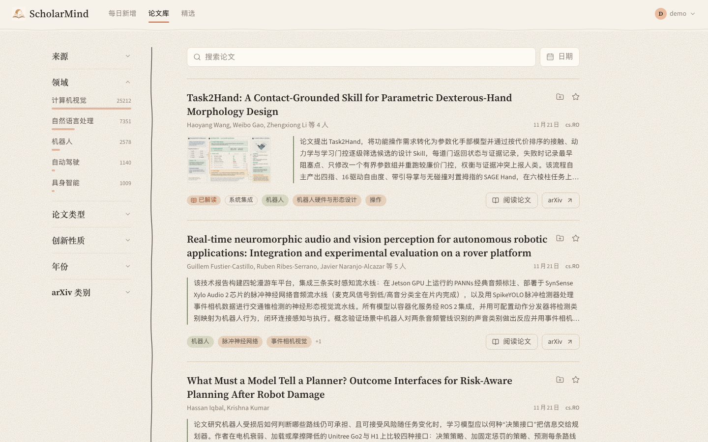
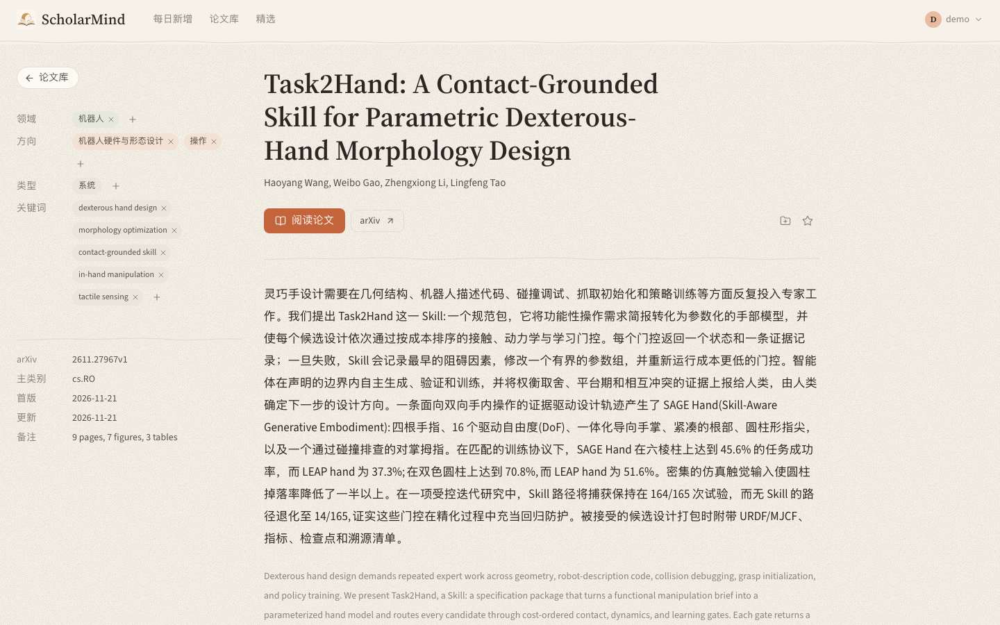
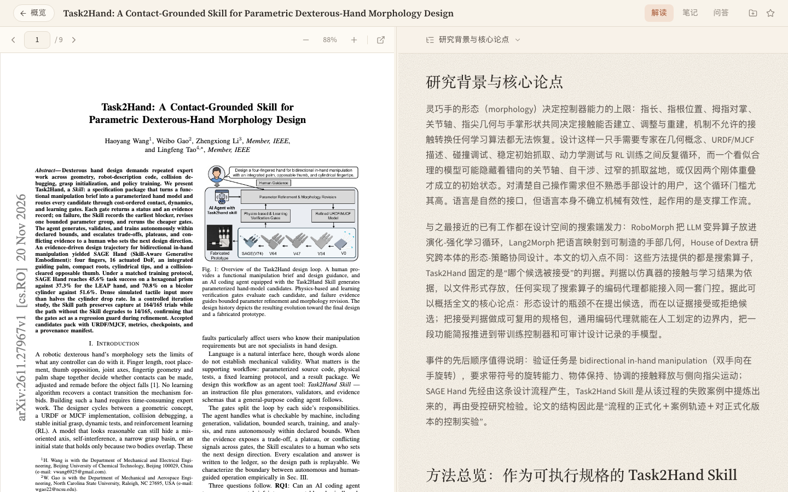
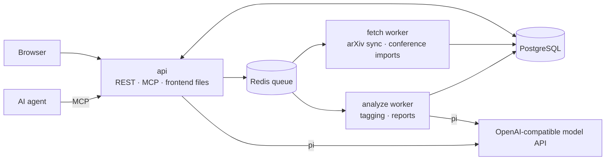

<p align="center">
  <picture>
    <source media="(prefers-color-scheme: dark)" srcset="assets/logo-dark.svg">
    
  </picture>
</p>

<p align="center"><a href="README.md">中文</a> · <b>English</b></p>

<p align="center">
  <b>Your research group's own paper library: papers collected, tagged and explained automatically, with people and AI agents working from the same data</b>
</p>

<p align="center">
  <a href="LICENSE"></a>
  <a href="https://github.com/xiongqi123123/ScholarMind/releases"></a>
  
  
  
  
  
  
</p>

<p align="center">
  <a href="#why-we-built-this">Why</a> ·
  <a href="#features">Features</a> ·
  <a href="#quick-start">Quick start</a> ·
  <a href="#using-it-from-an-agent-mcp">MCP</a> ·
  <a href="docs/ARCHITECTURE.md">Architecture</a> ·
  <a href="docs/TODO.md">Roadmap</a>
</p>

<p align="center">
  <a href="assets/promo/scholarmind-promo-en.mp4"></a>
  <br>
  <sub>▶ 43-second promo video: <a href="assets/promo/scholarmind-promo-en.mp4">English</a> · <a href="assets/promo/scholarmind-promo-zh.mp4">中文</a></sub>
</p>

ScholarMind is a self-hosted paper library. It syncs arXiv every day and imports conference proceedings, has a language model tag every paper with its domains and research topics, and writes reports, illustrated with the paper's own figures, on the papers you care about. People in the group filter, read, take notes and ask questions about papers in the browser; AI agents query the same data over MCP. One instance serves one research group: the data, accounts and vocabulary stay on your own server, and the model can be any OpenAI-compatible API. The web interface is in Chinese only for now.

## Why we built this

Everyone doing research deals with the same thing every day: there are far too many new papers, and very few of them are about what you work on. In our group, the trouble came down to these.

**Too many papers to look at, and finding the right ones is luck.** In cs.CV and cs.RO alone, arXiv posts several hundred new papers and new versions a day. Nobody reads every title. In practice people go by what others share in newsletters, group chats and on social media, so which papers you see depends on what crossed your feed that day.

**Sources are scattered, and none is organized around your own research.** arXiv is one site; CVPR and ICCV are on CVF; NeurIPS and ICLR each have a proceedings site, ICML is on PMLR, and the robotics and NLP conferences are somewhere else again. To answer "which papers on dexterous hands came out in the last three years", you search a dozen sites one by one and deduplicate the results yourself.

**Existing tools each cover one piece.** Reference managers keep the papers you have already found; they don't help you find them. General academic search and recommendation services don't know which areas your group cares about, and their categories aren't yours. Dropping a PDF into a chat model gets you a summary, but a one-off one: nothing is kept, the next person asks again, there are no original figures, and it can't say which page a statement came from.

**Reading isn't shared within the group.** A paper a senior student has already read and understood, a junior student reads again from scratch. Who filed which paper under what, and who wrote which notes, stays on each person's laptop. Three months after a paper was presented at group meeting, nobody can find what was concluded about it.

**AI agents have no reliable library to search.** Letting an agent search the web for papers gives results that vary from run to run, and it can't see what your group has already read and tagged. What it needs is a structured, searchable local library with full text.

**Handing the data to a third-party service doesn't fit.** Which directions the group is following and what notes it keeps are part of the research. The model API keys and usage are better kept in your own hands too.

ScholarMind combines all of this into one pipeline that runs on the group's own machine:

| Problem | What ScholarMind does |
| --- | --- |
| Too many to look at | Every paper is tagged with domains, topics, paper type and keywords, plus a short summary; each day's new papers get their own page, and filtering by your topics leaves a few dozen |
| Scattered sources | A daily arXiv sync plus imports from 13 top conferences, all in one library; the conference and arXiv versions of a paper are merged automatically |
| Summaries that aren't kept and cite nothing | A report is a stored article whose figures and tables are cropped from the PDF, shared by the whole group; answers to questions about a paper give page numbers that jump to the source |
| Reading isn't shared | Tags and reports are visible to the whole group and anyone can edit them; notes and favorites are personal |
| Agents have nothing to search | The same data is open to agents over MCP: search, metadata and reports, the full text page by page, notes |
| Data on someone else's server | Self-hosted, with PostgreSQL as the single source of truth; you configure the model API, keys and prompts |

## Features

<table>
<tr>
<td width="50%" valign="top">

**Collecting papers**

- Syncs the configured arXiv categories every day; new papers and new versions both count as that day's additions
- 13 conferences built in: NeurIPS, ICML, ICLR, CVPR, ICCV, ECCV, ICRA, IROS, RSS, ACL, EMNLP, AAAI and ACM MM, main-conference papers only
- The conference and arXiv versions of a paper are merged into one record

</td>
<td width="50%" valign="top">

**Tagging**

- The model reads the abstract and gives domains, research topics, paper type, keywords and a short summary (in Chinese by default)
- You define the topic vocabulary; when no topic fits, the model creates one, and duplicates are merged every week
- Anyone can edit the tags, and the model never overwrites an edited tag

</td>
</tr>
<tr>
<td valign="top">

**Reports**

- The model reads the full paper and writes a report several thousand words long; the figures and tables it cites are cropped from the PDF
- Every report ends with a section on what is doubtful in the paper
- Generated automatically for the topics you choose, or started by hand for any paper, with progress shown

</td>
<td valign="top">

**Reading**

- The PDF and the report side by side; select text in the paper to save it with a comment
- Ask the model about the paper; page numbers in its answers link back into the PDF
- A sentence-by-sentence Chinese translation of the abstract on the details page

</td>
</tr>
<tr>
<td valign="top">

**Finding papers**

- Filter by source, domain, topic, type and year; full-text search over titles and abstracts
- Each day's new papers, personal favorites and favorite folders

</td>
<td valign="top">

**For agents and admins**

- `/mcp` offers tools to search, read metadata and reports, read the full text page by page, and take notes
- Manage accounts, model connections and prompts in the browser; each person can create several personal tokens

</td>
</tr>
</table>

<p align="center"></p>

| Details page: tags, translated abstract | Reader: PDF and report, notes, questions |
| --- | --- |
|  |  |

## How it works



- The backend is Python 3.12 (FastAPI, SQLAlchemy, Alembic, RQ); the frontend is React + Vite, built into static files that the backend serves.
- Models are called only through [pi](https://pi.dev), and get no tools at all. Papers are untrusted input, so the model can neither run commands nor read or write files.
- PostgreSQL is the single source of truth; Redis is only a queue, and clearing it loses nothing. PDFs aren't stored: they are fetched from the original site when opened.
- One image, and one container runs every process: the api, the scheduler, one fetch worker and a configurable number of analyze workers.

The design decisions and the reasoning behind each are in [docs/ARCHITECTURE.md](docs/ARCHITECTURE.md) (in Chinese).

## Quick start

You need a machine with Docker and the Compose plugin (`docker compose`), and an OpenAI-compatible model API. Compose starts PostgreSQL 17 and Redis 8 along with the app.

```bash
git clone https://github.com/xiongqi123123/ScholarMind.git && cd ScholarMind
cp .env.example .env                 # two passwords, SECRET_KEY, LLM_API_KEY
cp config.example.yaml config.yaml   # model API URL and model names, sync times
docker compose up -d
```

The first start builds the image, which takes a few minutes; then PostgreSQL and Redis start, the tables are created and the app starts. If `docker compose up -d` reports an error, `docker compose logs` shows why.

Open `http://<host>:8000`, create the first admin account, and follow the setup wizard: connect the model API, choose arXiv categories, choose the conferences to import and the year to start from (it estimates the number of papers and the tokens tagging them will take), then start syncing. From then on, every day at the time set in `sync.cron` in `config.yaml`, it syncs arXiv and tags the new papers.

While the library has no accounts, anyone who opens the page can create the first admin, so do that as soon as the containers are up.

To update to a new version: `git pull && docker compose up -d --build`. The migrations run before the new app starts.

<details>
<summary><b>Or from the command line</b></summary>

```bash
docker compose exec app scholarmind create-user alice --admin   # create an admin (prompts for a password)
docker compose exec app scholarmind sync                        # sync arXiv now
docker compose exec app scholarmind import-venue CVPR 2026      # import one conference edition
docker compose exec app scholarmind import-venues --since 2022  # queue every edition since 2022
```

If you deployed with `docker run`, use `docker exec -it scholarmind` instead of `docker compose exec app`.

</details>

<details>
<summary><b>Alternatively: your own PostgreSQL and Redis, with docker run</b></summary>

If you already run PostgreSQL and Redis, you can run only the app container. We run on PostgreSQL 17 and Redis 8 and use no database extensions. Create the database and user in `DATABASE_URL` and the Redis database in `REDIS_URL` first.

```bash
cp .env.example .env                 # uncomment and fill in DATABASE_URL and REDIS_URL, then SECRET_KEY, LLM_API_KEY
cp config.example.yaml config.yaml

docker build -t scholarmind .

# Create the tables
docker run --rm --env-file .env -v ./config.yaml:/app/config.yaml:ro scholarmind alembic upgrade head

# Start
docker run -d --name scholarmind --restart always -p 8000:8000 \
  --env-file .env -v ./config.yaml:/app/config.yaml:ro -e ANALYZE_WORKERS=2 -e TZ=Asia/Shanghai \
  scholarmind
```

To build with package mirrors, see the top of the [Dockerfile](Dockerfile). Updates work the same way: build, migrate, then replace the container.

</details>

<details>
<summary><b>Things to know when deploying</b></summary>

- Package mirrors: where the official sources are slow or blocked, set `PIP_INDEXES` and `NPM_REGISTRIES` in `.env` (examples in [.env.example](.env.example)). Pulling the `node`, `python`, `postgres` and `redis` base images goes through the Docker daemon's own registry mirror or proxy settings. If reaching arXiv needs a proxy, set `HTTPS_PROXY` in `.env`; the compose build passes it to pip and npm too.
- When serving over HTTPS, set `COOKIE_SECURE` to `true` in `.env` and put any reverse proxy in front. Answers to questions are streamed (SSE), so the reverse proxy must not buffer responses.
- Memory: the api takes about 60 MB, each analyze worker about 150 MB at work and about 400 MB while writing a report. Choose `ANALYZE_WORKERS` by the machine's memory and the concurrency your model API allows; when the API rate-limits, jobs wait on their own.
- With compose, `ANALYZE_WORKERS` defaults to 2 and `TZ` to `Asia/Shanghai` (the time zone of `sync.cron` and the other schedules); change either in `.env`.
- The data is in the Docker volume `scholarmind_postgres`; Redis is only a queue. `docker compose down` keeps the data, but `down -v` deletes the database too. To back up: `docker compose exec -T postgres pg_dump -U scholarmind scholarmind > scholarmind.sql`.
- To have CI deploy to a Docker host once the checks pass (build, migrate, switch over, roll back on failure), the script and instructions are in [deploy/](deploy/README.md).
- The service is designed for an internal network: there is no sign-up, an admin creates the accounts, and every endpoint requires a login or a token, except creating the first admin (open only while there are no accounts). Judge for yourself before putting it on the public internet.

</details>

## Configuration

`config.yaml`; [config.example.yaml](config.example.yaml) is an example with every option commented:

| Section | Contents |
| --- | --- |
| `arxiv` | Which categories to sync every day; once an admin has chosen them in the browser, those are used |
| `sync` | When the daily sync and the weekly conference check run |
| `venues` | Change, add or remove built-in conferences |
| `vocabulary` | Domains and the starting topic vocabulary; left out, the built-in one is used (computer vision, natural language processing, robotics, embodied AI, autonomous driving; 68 topics) |
| `analysis` | Model API URL, the models for tagging and for reports, batch size, the topics that get reports automatically and the daily limit, output language |

`.env` holds the connection settings and secrets and stays out of the repository. Admins can also change the arXiv categories, the model API URL, key and model names, and the six prompts (tagging, reports, novelty type, topic merging, questions, abstract translation) in the browser. Changes apply from the next job, with no restart. What is set in the browser takes precedence; resetting it there goes back to the values in `config.yaml` and `.env`. Keys set in the browser are stored encrypted in the database.

## Cost

Orders of magnitude we measured with a flash-tier model; other models will differ:

| Task | Tokens | Time |
| --- | --- | --- |
| Tagging, in batches of 20 | about 0.6–1.2k per paper | 0.5–3 minutes per batch |
| Report, per paper | 25k–65k | 1.5–8 minutes |
| Abstract translation, per paper, the first time it is opened | about 2k | 10–20 seconds |
| A question | about 25k (the full text goes along) | first words within seconds |

Importing every edition of the 13 conferences since 2022, about 100,000 papers, takes about 100 million tokens to tag. Reports are not generated automatically by default.

## Using it from an agent (MCP)

The library serves MCP (Streamable HTTP) at `/mcp`:

| Tool | Purpose |
| --- | --- |
| `search_papers` | Search by keywords, tags, topic, conference and date; optionally only your own favorites, or one day's new arXiv papers |
| `get_paper` | Metadata, tags, report |
| `read_paper` | Read the full text page by page |
| `save_note`, `list_notes`, `delete_note` | Notes, visible only to the token's owner |

Comparing papers, finding research gaps and the like aren't tools: the agent works them out itself with the tools above.

Tokens are created on the profile page in the browser, one for each agent or machine. Each has its own name, an optional expiry and can be revoked on its own; it is shown only once, when created. To connect Claude Code:

```bash
claude mcp add --transport http scholarmind https://<your-domain>/mcp \
  --header "Authorization: Bearer <your-token>"
```

This adds it to the current project only (`--scope local`); add `--scope user` to use it in every project. Other clients take the same URL and header. If you put it in a project's `.mcp.json`, don't commit the token; use an environment variable:

```json
{"mcpServers": {"scholarmind": {"type": "http", "url": "https://<your-domain>/mcp",
  "headers": {"Authorization": "Bearer ${SCHOLARMIND_TOKEN}"}}}}
```

## Command line

The same `scholarmind` command works in the container and in a development environment; `scholarmind <command> --help` shows the options.

| Command | Purpose |
| --- | --- |
| `create-user`, `set-password`, `reset-token` | Create an account, reset a password, issue a personal token |
| `sync` | Sync arXiv now; `--from/--until` fetches a past date range |
| `import-venue`, `import-venues`, `check-venues` | Import one conference edition, queue several, check for a new edition |
| `brief` | Tag new papers; `--enqueue` hands them to the workers, `--redo` requeues failed ones and those tagged with an old prompt |
| `report`, `assess` | Write reports on the given papers, judge their novelty type |
| `topics` | Sync the starting vocabulary, or merge duplicate created topics now |
| `worker`, `cron` | Background processes; the container starts them for you |

## Local development

<details>
<summary><b>Environment, commands and checks</b></summary>

You need PostgreSQL, Redis and [pi](https://pi.dev) (`npm i -g @earendil-works/pi-coding-agent@1.5.2`, Node 22.19 or later). The commands below use conda; a venv works just as well.

```bash
conda create -n ScholarMind python=3.12 -y
conda run -n ScholarMind pip install -e "backend[dev]"
cp .env.example .env                 # uncomment DATABASE_URL and REDIS_URL and point them at your databases
cp config.example.yaml config.yaml

cd backend
conda run -n ScholarMind alembic upgrade head
conda run --no-capture-output -n ScholarMind scholarmind create-user alice --admin
conda run -n ScholarMind scholarmind sync
conda run -n ScholarMind scholarmind brief --limit 20
conda run -n ScholarMind uvicorn scholarmind.api:app --reload
```

- Start the background processes you need separately: `scholarmind worker fetch` (only one), `scholarmind worker analyze` (as many as you like), `scholarmind cron` (only one).
- Frontend: `cd frontend && npm install && npm run dev`; the dev server forwards `/api` to the backend. After `npm run build`, the backend serves `frontend/dist` itself. See [frontend/README.md](frontend/README.md) (in Chinese).
- Checks: `ruff check .` and `pytest` in `backend/` (the tests run in a temporary schema and leave existing data alone; `TEST_DATABASE_URL` can point them at a separate test database), `npm run lint` and `npm run typecheck` in `frontend/`.
- pi's config directory is `PI_CODING_AGENT_DIR` (default `.cache/pi-agent`). The `models.json` in it is regenerated before every call, and your own `~/.pi` is never used.

</details>

## Status and roadmap

This is 0.2.0: on top of 0.1.0, the first usable release, it adds a setup wizard in the browser and deployment with docker compose. It runs every day in a research group of about ten people, with around 100,000 papers in the library. Known limitations:

- The interface is in Chinese only. Reports and abstract translations are in Chinese; the language of brief summaries can be changed with `analysis.language`, but the prompts and the checks on their output are written for Chinese.
- For conferences without open PDFs (ICRA, IROS, ACM MM and others), only papers that also have an arXiv version can get reports.
- The quality of reports, answers and translations depends on the model you connect; the doubts section at the end of a report is the model's opinion, not a reviewer's verdict.
- There is no multi-tenancy, public sign-up or third-party login.

What comes next is in [docs/TODO.md](docs/TODO.md) (in Chinese). Issues and pull requests are welcome.

## Acknowledgements

- Paper metadata comes from arXiv's open API. Thank you to arXiv for use of its open access interoperability.
- Conference papers come from [OpenAlex](https://openalex.org), CVF Open Access, ECVA, PMLR and the official NeurIPS and ICLR proceedings sites.
- Models are called through [pi](https://pi.dev); PDFs are parsed with [pypdfium2](https://github.com/pypdfium2-team/pypdfium2), and the reader uses [PDF.js](https://mozilla.github.io/pdf.js/).

## License

[Apache License 2.0](LICENSE)
