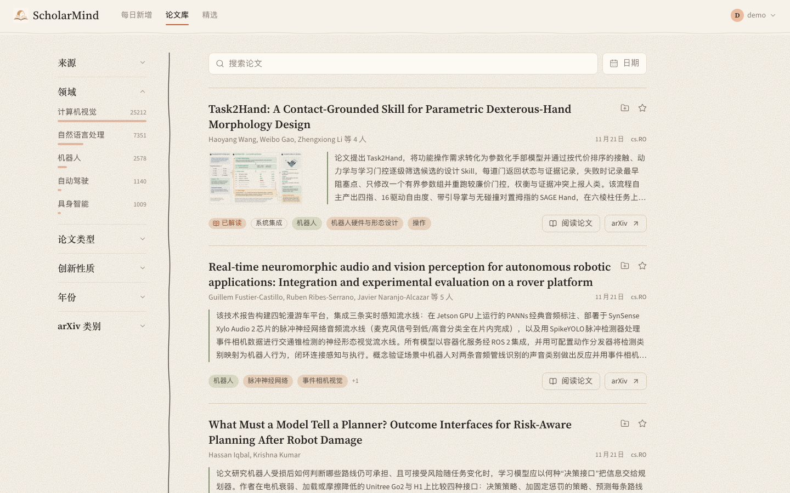
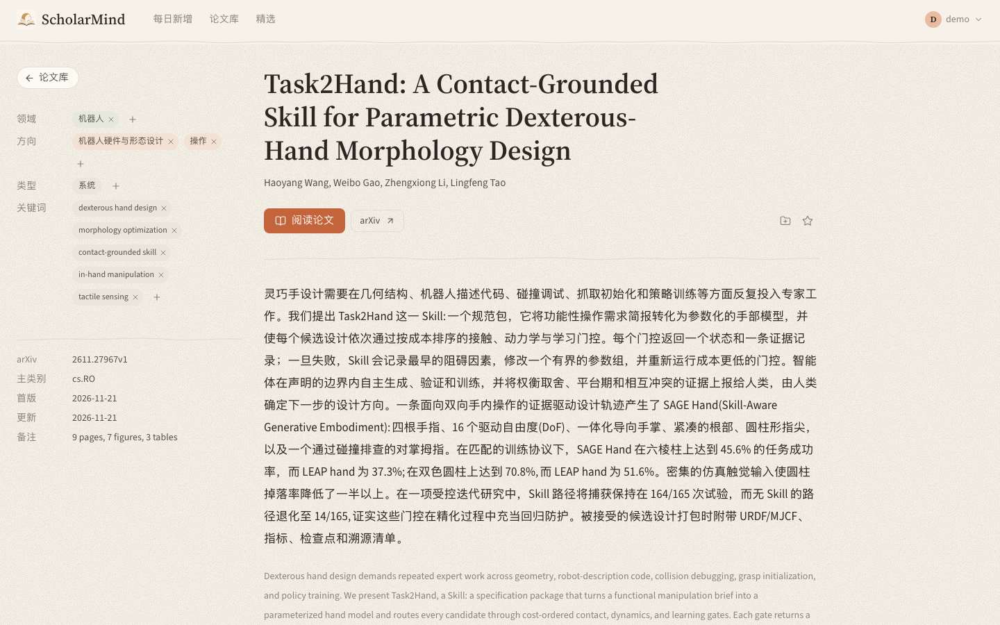
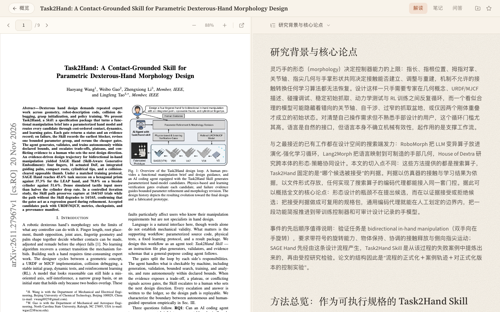
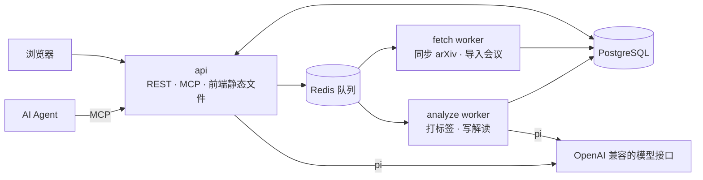

<p align="center">
  <picture>
    <source media="(prefers-color-scheme: dark)" srcset="assets/logo-dark.svg">
    
  </picture>
</p>

<p align="center">
  <b>课题组自己的论文库：自动收论文、打标签、写解读，人和 AI Agent 用同一份数据</b>
</p>

<p align="center">
  <a href="LICENSE"></a>
  <a href="https://github.com/xiongqi123123/ScholarMind/releases"></a>
  
  
  
  
  
  
</p>

<p align="center">
  <a href="#为什么做这个">为什么做这个</a> ·
  <a href="#功能">功能</a> ·
  <a href="#快速开始">快速开始</a> ·
  <a href="#在-agent-里用mcp">MCP</a> ·
  <a href="docs/ARCHITECTURE.md">架构</a> ·
  <a href="docs/TODO.md">路线图</a>
</p>

<p align="center">
  <a href="assets/promo/scholarmind-promo-zh.mp4"></a>
  <br>
  <sub>▶ 43 秒宣传片：<a href="assets/promo/scholarmind-promo-zh.mp4">中文</a> · <a href="assets/promo/scholarmind-promo-en.mp4">English</a></sub>
</p>

ScholarMind 是一个自己部署的论文库。它每天同步 arXiv、导入顶会论文集，用大模型给每一篇打上领域和方向的标签，给你关心的论文写带原图的解读；组里的人在网页上筛选、阅读、做笔记、向论文提问，AI Agent 通过 MCP 查同一份数据。一个实例对应一个课题组，数据、账号和词表都在你自己的服务器上，模型接任何 OpenAI 兼容的接口。

## 为什么做这个

做研究的人每天都在处理同一件事：新论文太多，而真正和自己有关的很少。我们组在这件事上遇到的麻烦大致是这几样。

**论文多到看不过来，筛选靠运气。** 光 cs.CV 和 cs.RO 两个类别，arXiv 一天就有几百篇新论文和新版本。没有人能逐篇看标题，大家实际靠的是公众号、群聊和社交媒体上别人转发了什么，看到哪篇取决于那天刷到了什么。

**来源分散，没有一个按自己方向整理好的地方。** arXiv 是一个站，CVPR、ICCV 在 CVF，NeurIPS、ICLR 各有论文集站点，ICML 在 PMLR，机器人和 NLP 的会议又在别处。想回答"这三年做灵巧手的论文有哪些"，要在十几个站点上分别搜，再自己去重。

**现成的工具各管一段。** 文献管理软件管的是你已经找到的论文，不负责帮你找；通用的学术搜索和推荐不知道你们组关心什么方向，分类体系也不是你的；把 PDF 丢给对话模型能得到一份总结，但那是一次性的，结果不沉淀，下一个人还得再问一遍，而且总结里没有原图，也说不清哪句话出自哪一页。

**组里的阅读不共享。** 师兄读过并且看懂了的论文，师弟还要从头读；谁给哪篇论文归了什么类、记了什么笔记，都留在各自的电脑里。组会上讲过的论文，三个月后没人找得到当时的结论。

**AI Agent 做调研时没有可靠的库可查。** 让 Agent 联网搜论文，结果不稳定、不可复现，也查不到你们组已经读过、标过的东西。它需要的是一个结构化、可检索、带全文的本地论文库。

**把数据交给第三方服务并不合适。** 组里在看什么方向、记了什么笔记，是研究工作的一部分；模型接口的密钥和用量也希望在自己手里。

ScholarMind 的做法是把这些合成一条流水线，跑在组里自己的机器上：

| 问题 | ScholarMind 的做法 |
| --- | --- |
| 看不过来 | 每篇论文自动打上领域、方向、类型和关键词，并写一段中文概要；每天的新增单独成页，按你们的方向筛一下就剩几十篇 |
| 来源分散 | arXiv 每日同步加 13 个顶会的导入，进同一个库，同一篇论文的会议版和 arXiv 版自动合并 |
| 总结不沉淀、没出处 | 解读是一篇存下来的文章，图和表是从 PDF 里裁的原图，全组共用；向论文提问时回答带页码，点一下跳到原文 |
| 阅读不共享 | 标签和解读全组可见、人人可改；笔记和收藏是个人的 |
| Agent 没库可查 | 同一份数据通过 MCP 开放：搜索、取元数据和解读、按页读原文、记笔记 |
| 数据在别人那里 | 自己部署，PostgreSQL 是唯一的数据来源；模型接口、密钥、提示词都由你配置 |

## 功能

<table>
<tr>
<td width="50%" valign="top">

**收论文**

- 每天按配置的类别同步 arXiv，新论文和新版本都算当天的新增
- 内置 13 个顶会：NeurIPS、ICML、ICLR、CVPR、ICCV、ECCV、ICRA、IROS、RSS、ACL、EMNLP、AAAI、ACM MM，只收主会论文
- 会议版和 arXiv 版自动合并成一条

</td>
<td width="50%" valign="top">

**打标签**

- 模型读摘要，给出领域、研究方向、论文类型、关键词和中文概要
- 方向词表自己定；模型遇到没有的方向会新建，每周自动合并重复的
- 标签人人可改，改过的不会再被模型覆盖

</td>
</tr>
<tr>
<td valign="top">

**写解读**

- 模型读全文写一篇几千字的解读，引用的图表是从 PDF 裁出的原图
- 最后固定有一节"存疑之处"
- 可以按方向自动生成，也可以对任意一篇手动触发，有进度显示

</td>
<td valign="top">

**读论文**

- PDF 和解读并排；划选原文做摘录批注
- 就这一篇向模型提问，回答里的页码可以点回 PDF
- 详情页有摘要的逐句中译

</td>
</tr>
<tr>
<td valign="top">

**找论文**

- 按来源、领域、方向、类型、年份筛选，标题和摘要全文检索
- 每日新增、个人收藏和收藏分组

</td>
<td valign="top">

**给 Agent 和管理员**

- `/mcp` 提供搜索、读取、按页读原文、记笔记的工具
- 网页上管账号、改模型连接和提示词；每人可以发多个个人令牌

</td>
</tr>
</table>

<p align="center"></p>

| 详情页：标签、摘要中译 | 阅读页：PDF 与解读、笔记、问答 |
| --- | --- |
|  |  |

## 工作方式



- 后端 Python 3.12（FastAPI、SQLAlchemy、Alembic、RQ），前端 React + Vite，构建成静态文件由后端托管。
- 模型只通过 [pi](https://pi.dev) 调用，不给模型任何工具。论文是不可信的输入，模型既不能执行命令，也不能读写文件。
- PostgreSQL 是唯一的数据来源；Redis 只做队列，清空不丢数据。PDF 不保存，打开时从原站点取。
- 一个镜像、一个容器跑全部进程：api、定时器、一个 fetch worker、若干 analyze worker。

设计上的取舍和每一步的理由见 [docs/ARCHITECTURE.md](docs/ARCHITECTURE.md)。

## 快速开始

需要你自己准备 PostgreSQL、Redis 和一个 OpenAI 兼容的模型接口。我们在 PostgreSQL 17 和 Redis 8 上运行，没有用到数据库扩展。

```bash
git clone https://github.com/xiongqi123123/ScholarMind.git && cd ScholarMind
cp .env.example .env                 # 数据库和 Redis 连接、SECRET_KEY、LLM_API_KEY
cp config.example.yaml config.yaml   # 同步时间、模型接口地址和模型名

docker build -t scholarmind .

# 建表
docker run --rm --env-file .env -v ./config.yaml:/app/config.yaml:ro scholarmind alembic upgrade head

# 启动
docker run -d --name scholarmind --restart always -p 8000:8000 \
  --env-file .env -v ./config.yaml:/app/config.yaml:ro -e ANALYZE_WORKERS=2 -e TZ=Asia/Shanghai \
  scholarmind
```

打开 `http://<主机>:8000`，先建第一个管理员账号，然后跟着初始化向导走完：连上模型接口，选 arXiv 类别，选要导入的顶会和起始年份（会给出预计篇数和打标签的 token），最后开始同步。之后每天到 `config.yaml` 里 `sync.cron` 的时间，会自动同步 arXiv 并给新论文打标签。

库里还没有任何账号时，谁打开这个页面都能建第一个管理员，所以容器起来后尽快建好。

<details>
<summary><b>也可以用命令行</b></summary>

```bash
docker exec -it scholarmind scholarmind create-user alice --admin  # 建管理员（会提示输入密码）
docker exec scholarmind scholarmind sync                           # 现在就同步一次 arXiv
docker exec scholarmind scholarmind import-venue CVPR 2026         # 导入一届会议
docker exec scholarmind scholarmind import-venues --since 2022     # 排队导入 2022 年起的各届
```

</details>

<details>
<summary><b>部署时要知道的几件事</b></summary>

- 国内构建可以给 `docker build` 加镜像源，写法见 [Dockerfile](Dockerfile) 开头；访问 arXiv 需要代理时在 `.env` 里设 `HTTPS_PROXY`。
- 通过 HTTPS 提供服务时把 `.env` 里的 `COOKIE_SECURE` 设为 `true`，前面放任意反向代理即可。问答是流式输出（SSE），反向代理不要缓冲响应。
- 内存：api 约 60 MB，每个 analyze worker 工作时约 150 MB，写解读时约 400 MB。`ANALYZE_WORKERS` 按机器内存和模型接口允许的并发定；接口限流时任务会自己等待。
- 仓库里目前没有 docker compose 文件。想让 CI 在检查通过后自动部署到一台 Docker 主机（构建、迁移、切换、失败回滚），脚本和说明在 [deploy/](deploy/README.md)。
- 这个服务按内网使用设计：没有注册入口，账号由管理员创建，除了建第一个管理员（只在一个账号都没有时开放），所有接口都要登录或令牌。放到公网前请自己评估。

</details>

## 配置

`config.yaml`，示例和每一项的注释见 [config.example.yaml](config.example.yaml)：

| 段落 | 内容 |
| --- | --- |
| `arxiv` | 每天同步哪些类别；管理员在网页上选过的话以网页为准 |
| `sync` | 每日同步、每周会议检查的时间 |
| `venues` | 调整或增删内置的会议 |
| `vocabulary` | 领域和起步的方向词表；不写就用内置的（计算机视觉、自然语言处理、机器人、具身智能、自动驾驶，68 个方向） |
| `analysis` | 模型接口地址、打标签和写解读各用的模型、每批篇数、自动写解读的方向和每日上限、输出语言 |

`.env` 放连接串和密钥，不进仓库。arXiv 类别、模型接口地址、密钥、模型名和六个提示词（打标签、解读、创新性质、方向合并、问答、摘要翻译）也可以由管理员在网页上改，改完从下一个任务起生效，不用重启；网页上设了的以网页为准，恢复默认就回到 `config.yaml` 和 `.env` 的值。在网页上设的密钥加密后存库。

## 成本

以下是我们用 flash 档模型实测的量级，换模型会不一样：

| 任务 | 用量 | 耗时 |
| --- | --- | --- |
| 打标签，20 篇一批 | 每篇约 0.6–1.2 千 token | 每批 0.5–3 分钟 |
| 解读，每篇 | 2.5–6.5 万 token | 1.5–8 分钟 |
| 摘要翻译，每篇，第一次打开时 | 约 2 千 token | 10–20 秒 |
| 提问，每次 | 约 2.5 万 token（带上全文） | 几秒出第一个字 |

导入 2022 年起 13 个会议的各届共约十万篇，打标签约一亿 token。解读默认不自动生成。

## 在 Agent 里用（MCP）

论文库在 `/mcp` 提供 MCP（Streamable HTTP）：

| 工具 | 作用 |
| --- | --- |
| `search_papers` | 按关键词、标签、方向、会议、日期搜索；可以只看自己收藏的，或 arXiv 某一天的新增 |
| `get_paper` | 元数据、标签、解读 |
| `read_paper` | 按页读原文 |
| `save_note`、`list_notes`、`delete_note` | 笔记，只有令牌的主人看得到 |

比较论文、找研究空白这类事不做成工具，交给 Agent 自己用上面几个工具推理。

令牌在网页的个人信息页生成，每个 Agent 或机器一个，各自命名、可设过期、可单独作废，只在生成时显示一次。在 Claude Code 里接上：

```bash
claude mcp add --transport http scholarmind https://<你的域名>/mcp \
  --header "Authorization: Bearer <你的令牌>"
```

默认只加到当前项目（`--scope local`）；想所有项目都能用就加 `--scope user`。其他客户端填同样的地址和请求头。写进项目的 `.mcp.json` 时别把令牌提交进仓库，用环境变量：

```json
{"mcpServers": {"scholarmind": {"type": "http", "url": "https://<你的域名>/mcp",
  "headers": {"Authorization": "Bearer ${SCHOLARMIND_TOKEN}"}}}}
```

## 命令行

容器里和开发环境里都是同一个 `scholarmind` 命令，`scholarmind <命令> --help` 看参数。

| 命令 | 作用 |
| --- | --- |
| `create-user`、`set-password`、`reset-token` | 建账号、重设密码、发个人令牌 |
| `sync` | 现在同步 arXiv；`--from/--until` 补拉一段日期 |
| `import-venue`、`import-venues`、`check-venues` | 导入一届会议、排队导入多届、检查有没有新的一届 |
| `brief` | 给新论文打标签；`--enqueue` 交给 worker，`--redo` 把失败的和旧提示词打的放回去 |
| `report`、`assess` | 给指定论文写解读、判定创新性质 |
| `topics` | 同步起步词表，或现在就合并重复的自建方向 |
| `worker`、`cron` | 后台进程，容器已经替你启动 |

## 本机开发

<details>
<summary><b>环境、命令和检查</b></summary>

需要 PostgreSQL、Redis 和 [pi](https://pi.dev)（`npm i -g @earendil-works/pi-coding-agent@1.5.2`，Node 22.19 以上）。下面用 conda，换成 venv 也一样。

```bash
conda create -n ScholarMind python=3.12 -y
conda run -n ScholarMind pip install -e "backend[dev]"
cp .env.example .env
cp config.example.yaml config.yaml

cd backend
conda run -n ScholarMind alembic upgrade head
conda run --no-capture-output -n ScholarMind scholarmind create-user alice --admin
conda run -n ScholarMind scholarmind sync
conda run -n ScholarMind scholarmind brief --limit 20
conda run -n ScholarMind uvicorn scholarmind.api:app --reload
```

- 后台进程按需另起：`scholarmind worker fetch`（只起一个）、`scholarmind worker analyze`（可起多个）、`scholarmind cron`（只起一个）。
- 前端：`cd frontend && npm install && npm run dev`，开发服务器把 `/api` 转给后端；`npm run build` 之后后端直接托管 `frontend/dist`。详见 [frontend/README.md](frontend/README.md)。
- 检查：`backend/` 下 `ruff check .` 和 `pytest`（在临时 schema 里跑，不碰已有数据；`TEST_DATABASE_URL` 可另指测试库），`frontend/` 下 `npm run lint` 和 `npm run typecheck`。
- pi 的配置目录是 `PI_CODING_AGENT_DIR`（默认 `.cache/pi-agent`），里面的 `models.json` 每次调用前重新生成，不会用到你自己的 `~/.pi`。

</details>

## 现状与路线图

这是 0.1.0，第一个可用的版本，在一个十来人的课题组里日常运行，库里约十万篇论文。已知的限制：

- 界面只有中文；模型输出的语言可以在 `analysis.language` 里改，但提示词和检查规则是按中文写的。
- ICRA、IROS、ACM MM 等不开放 PDF 的会议，只有在 arXiv 上有对应版本的论文能写解读。
- 解读、问答、摘要翻译的质量取决于你接的模型；解读里的"存疑之处"是模型的看法，不是审稿结论。
- 没有做多租户、公开注册和第三方登录。

接下来要做的事在 [docs/TODO.md](docs/TODO.md)。欢迎提 issue 和 PR。

## 致谢

- 论文元数据来自 arXiv 的开放接口。Thank you to arXiv for use of its open access interoperability.
- 会议论文来自 [OpenAlex](https://openalex.org)、CVF Open Access、ECVA、PMLR 以及 NeurIPS、ICLR 的官方论文集站点。
- 模型调用通过 [pi](https://pi.dev)，PDF 解析用 [pypdfium2](https://github.com/pypdfium2-team/pypdfium2)，阅读页用 [PDF.js](https://mozilla.github.io/pdf.js/)。

## 许可证

[Apache License 2.0](LICENSE)
